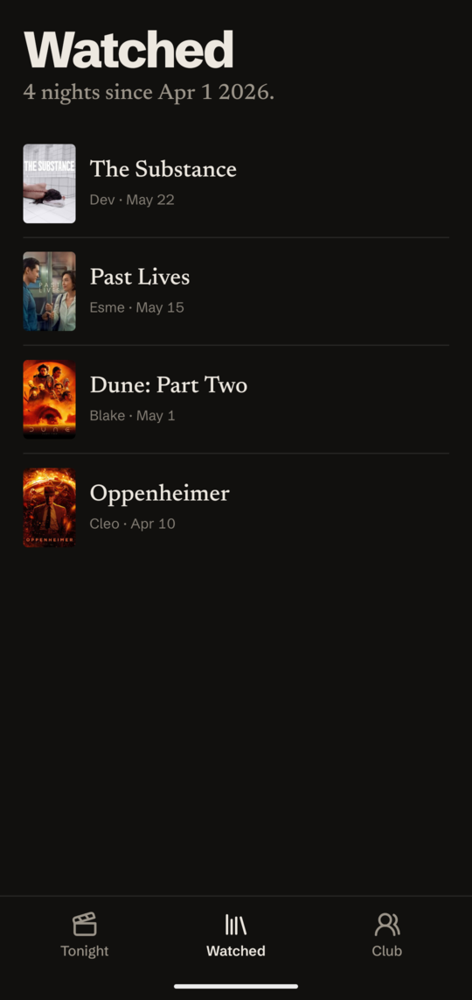

  

<h1 align="center">Movie Night</h1>

  <strong>Whose turn is it to pick?</strong> 
  A mobile app for a group of friends with a weekly movie night. 
  One pick a night. No voting, no vetoing.

  
  &nbsp;
  
  &nbsp;
  

Most movie apps help a group *agree* on a film. Movie Night does the opposite:
the group takes turns, and whoever's turn it is picks. The app keeps track of
whose turn it is.

## Features

- **A fair rotation.** The next pick goes to whoever has picked least. Missing
  a night delays your turn instead of losing it.
- **Plan a night.** Pick a date, mark who's coming, and the turn goes to the
  next person in line who's there. Then find the film, with posters from
  [TMDB](https://www.themoviedb.org), and it tells you if the group has
  already seen it.
- **Repeating nights.** Every week, every other week, or the same weekday
  each month. Once one night is watched or cancelled, the next one in the
  series is planned.
- **Tonight and Watched.** Tonight shows the next night, who picks after it,
  and any other nights already planned. When a night is over, "We watched it"
  records it on Watched with the film, who picked it, and who came.
- **Members and guests.** Guests can join and pick sometimes without entering
  the rotation.
- **Reminders** before each night, and **add to calendar** for one night or
  a whole weekly series.

## How it's built

| | |
|---|---|
| **[`mobile/`](mobile/README.md)** | Expo / React Native app in TypeScript |
| **[`backend/`](backend/README.md)** | Go HTTP API over PostgreSQL |
| **[`docs/adr/`](docs/adr)** | Architecture decision records |

Each component's README covers setup, running, and testing.
