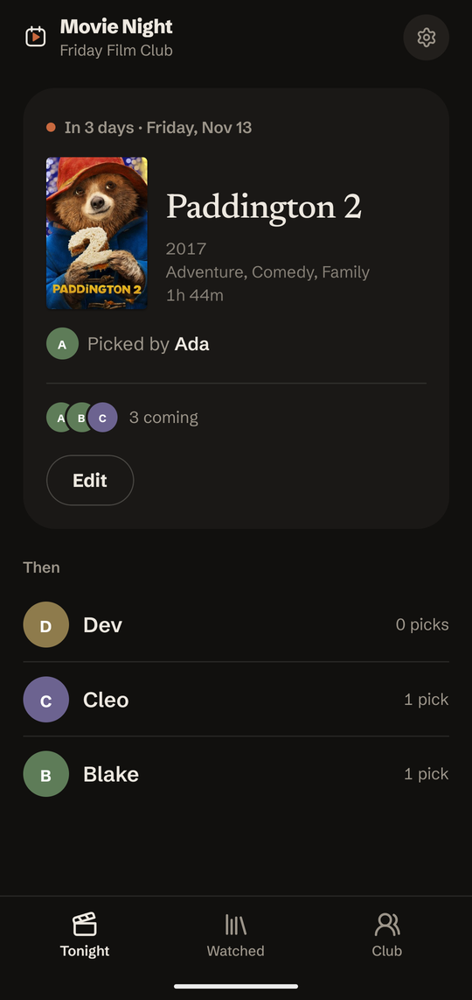
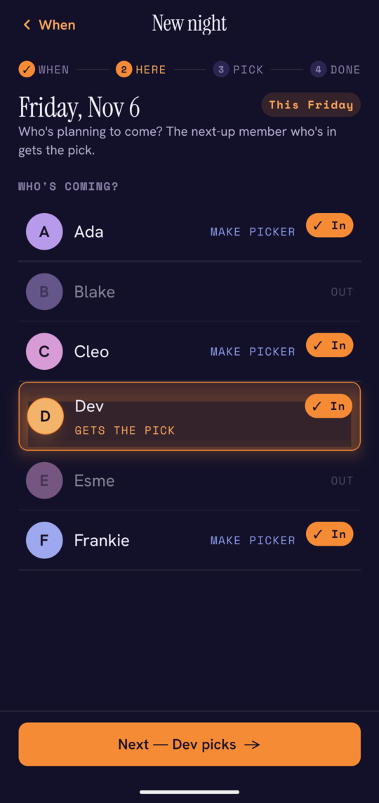
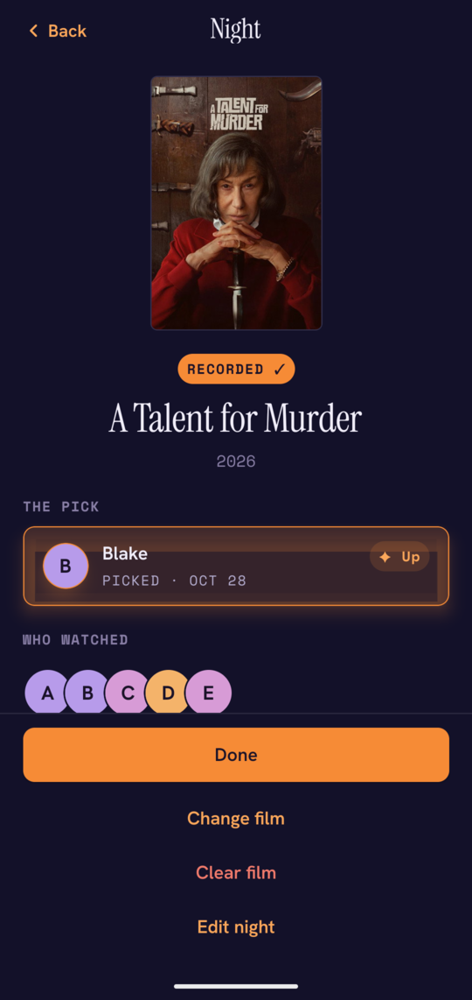
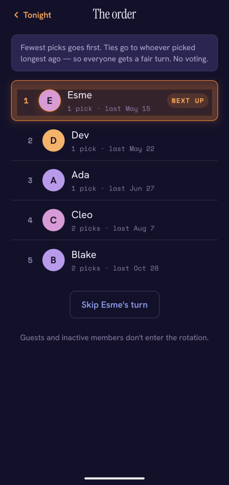
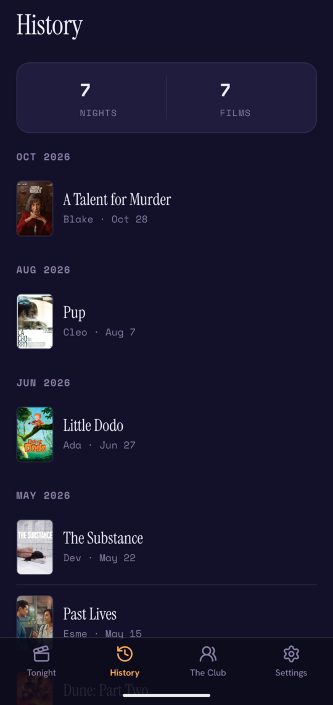
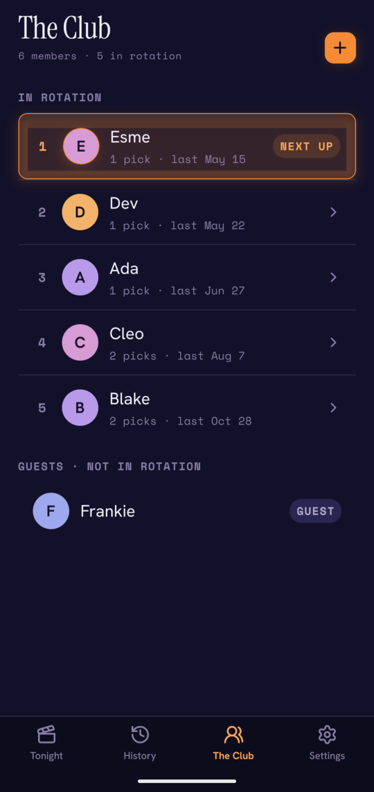

  

<h1 align="center">Movie Night</h1>

  <strong>Whose turn is it to pick?</strong> 
  A mobile app for a group of friends with a weekly movie night. 
  One pick a night. No voting, no vetoing.

  
  &nbsp;
  
  &nbsp;
  

Most movie apps help a group *agree* on a film (swipe until everyone matches).
Movie Night does the opposite. The group takes turns, and whoever's turn it is
picks the film. The app keeps track of the turns, so nobody has to remember
whose turn it is.

## Features

### A fair rotation, even when people miss nights

The next pick goes to the core member with the **fewest picks**. Ties go to
whoever picked **longest ago**. If the person next up can't make it, their turn
waits until they're back instead of being lost. They can also skip a turn
outright.

People join and leave over time. A new member starts level with the group
instead of owing a backlog of turns. A member who leaves is deactivated, not
deleted, so their past picks stay in History.

 

### Plan a night in four steps

**When → Here → Pick → Done.** Choose a date (and optionally a start time), tick
off who's coming, and the app hands the pick to the next-up member who's in.
The picker can be overridden, for example to let a guest choose. Then search
for the film. Search uses [TMDB](https://www.themoviedb.org), so every night
gets a poster and a year. A planned night can be added to your phone's
calendar.

### History of every night

Every night, newest first and grouped by month: the film, who picked it, and who
watched. The totals at the top count the club's nights and films. Any night can
be opened to change the film, the date, or who came.

 

### Members and guests

**The Club** lists the core members in rotation order, plus guests. Guests come
along and sometimes pick, but they're never owed a turn. Their history is kept
too, so a regular guest can be promoted to the rotation. Members can be
deactivated and reactivated at any time.

 

### No accounts

There are no emails or passwords. On first launch you pick your name from the
group's member list (or add yourself as a guest), and that phone remembers who
you are.

### Reminders

Push reminders go out before each night: the evening before, the morning of,
and two hours before. You can send them to everyone coming or only to the
picker. Whoever is picking always gets a nudge.

## How it's built

| | |
|---|---|
| **[`mobile/`](mobile/README.md)** | Expo (SDK 58) / React Native app in TypeScript, using expo-router. Its "Spotlight" design system: a deep indigo night sky, with one ember accent for whose turn it is. |
| **[`backend/`](backend/README.md)** | Go HTTP API (standard library `net/http`) over PostgreSQL, with sqlc and goose. Proxies TMDB and sends push reminders through Expo. |
| **[`docs/adr/`](docs/adr)** | Architecture decision records: the rotation rule, how members and guests work, identity, reminders, and more. |

Each component's README covers setup, running, and testing.
[`CLAUDE.md`](CLAUDE.md) has the commands and architecture notes in one place.
